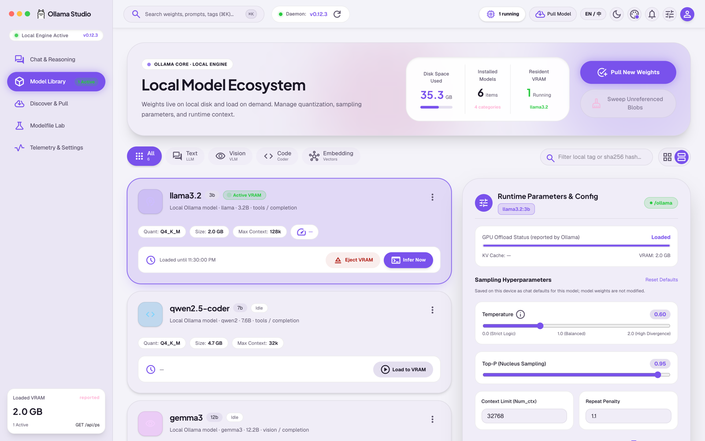
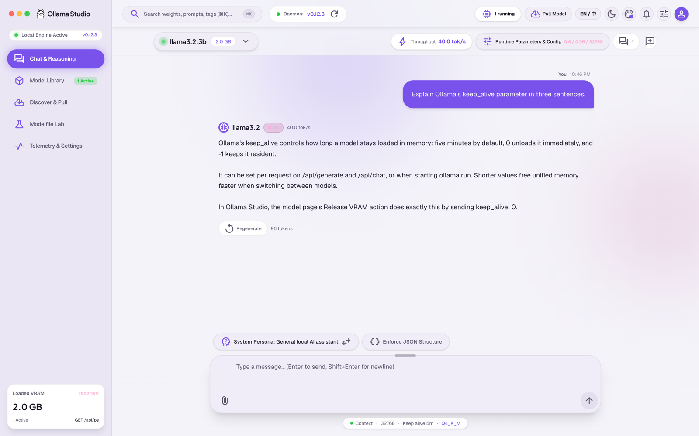
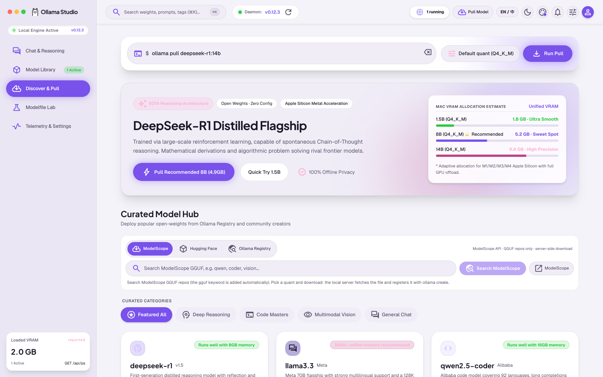
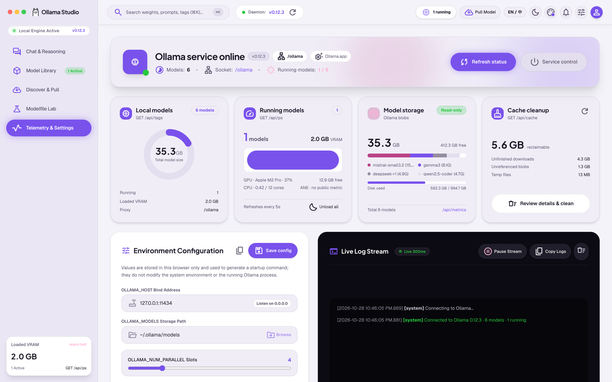

# Ollama Studio

**English** | [简体中文](README.zh-CN.md)

A macOS-style model manager and chat interface for local Ollama models. Model browsing, runtime status, streaming chat, pulls, delete/clone, Modelfile creation, and GGUF import/export all talk to your local Ollama instance; conversations, model parameters, and download metadata stay in the browser.

> Current status and next steps: [`docs/context/NOW.md`](docs/context/NOW.md); known risks: [`docs/context/RISKS.md`](docs/context/RISKS.md).

## UI Preview

> Screenshots use demo data and do not represent the models or hardware of a real machine. Click an image to open the full-size version.

| Model Library | Chat & Reasoning |
| --- | --- |
| [](docs/assets/screenshots/en/models.png) | [](docs/assets/screenshots/en/chat.png) |
| **Discover & Pull** | **Telemetry & Settings** |
| [](docs/assets/screenshots/en/pull.png) | [](docs/assets/screenshots/en/telemetry.png) |

## Project Overview

Ollama Studio brings the day-to-day work of running local models into one interface: browse and filter models, pull weights with quantization choices, chat with adjustable parameters, derive models with Modelfile, and inspect daemon and inference telemetry. The UI follows Material 3 Expressive with light/dark themes, five accent palettes, and Chinese/English localization.

This is a **runnable web application**. It listens on localhost by default; LAN access must be enabled explicitly and configured with a shared token.

## Current Status (verified 2026-10-28)

- Integrated `GET /api/version`, `GET /api/tags`, `GET /api/ps`, `POST /api/chat` (streaming NDJSON), `POST /api/pull` (NDJSON progress), `DELETE /api/delete`, `POST /api/copy`, `POST /api/create`, plus `ollama create` GGUF import and local blob export.
- Chat supports streaming output, stop generation, collapsible thinking content, temperature/topP/num_ctx, JSON mode, system persona, error display, and **multiple conversations per model** (create/switch/rename/delete).
- Fenced code blocks in replies render as dedicated code blocks with copy support.
- Model parameters are saved **per model as chat defaults** in `localStorage`; they never modify model weights. VRAM "load/release" uses `keep_alive` against the real API.
- Downloads run **server-side in the background**: pull tasks show real status, speed, ETA, and progress, and can be paused/resumed/cancelled. After a failure, the UI shows the exact command that will be rerun; "Retry" reruns it unchanged, while "Edit command" puts it back into the input for editing. ModelScope repository and file information persists across refreshes. Closing the page does not interrupt a download; reopening reconnects to the task and shows its progress.
- Model search supports **ModelScope (default)**, **Hugging Face**, and the **Ollama registry**; quantization labels are inferred from filenames. For ModelScope, the local server downloads the GGUF and then runs `ollama create` (Ollama cannot `pull` this source directly); progress and errors stream back as NDJSON.
- Telemetry includes **cache cleanup**: it scans the Ollama model directory and the application temp directory, groups unreferenced blobs, unfinished downloads (`*-partial` and chunk markers), and temp files, and deletes only selected categories. Blobs referenced by models, files written within the last 10 minutes, and partial files with an active download are protected. The confirmation dialog expands each category into per-file details (name, size, mtime, full path) and can reveal a file or directory in the system file manager (handled by the local server, so it also works in the web build).
- Telemetry shows real connection status, version, model/VRAM statistics, and an event log. The sidebar "Loaded VRAM / running models" counters and the telemetry page poll `/api/ps` every 5 seconds, so external load/unload operations appear without a manual refresh. `GET /api/metrics` reads filesystem capacity/used/free for the model directory, memory, CPU load, and macOS `ioreg` GPU utilization; unavailable values are labeled explicitly, and ANE has no public utilization API. Running model cards offer a confirmed **Unload all** action (`keep_alive: 0`).
- The model page exports the currently installed quantization as GGUF: the server reads the manifest, copies the `model` layer, and writes the `projector` layer as `*-mmproj.gguf`. The default directory is `~/Downloads/Ollama Studio`; duplicate names get numeric suffixes. Only weights are exported; template/license/params are not part of GGUF. Large files prefer APFS copy-on-write clones.
- The telemetry **Service Control** panel detects whether Ollama is managed by Ollama.app, launchd, Homebrew, systemd, or a plain process, and generates copyable restart/stop commands. Automatic execution is off by default and only runs when `ALLOW_DAEMON_CONTROL=1` is set, the request comes from loopback, and the user confirms. Environment settings can generate an `ollama serve` startup command, but never write to the system environment; restart Ollama manually for changes to take effect.
- The proxy binds to `127.0.0.1` by default. Optional `PROXY_TOKEN` protects `/ollama/*`, `/api/import`, `/api/modelscope/*`, `/api/downloads`, `/api/cache`, `/api/export`, `/api/metrics`, and `/api/daemon`.
- Fonts and Material Symbols are self-hosted; no Google Fonts dependency.
- Engineering: TypeScript `strict`, ESLint, Prettier, Vitest (117 tests), and GitHub Actions CI.
- Headless Chrome smoke tests cover the development/production first screen, real model list, export, and telemetry pages. A full page-by-page visual/a11y review has **not** been performed.
- Direct Hugging Face pulls are still limited by local DNS; use the ModelScope channel by default, or download a GGUF manually and import it.

For detailed status, blockers, and next steps, see [`docs/context/NOW.md`](docs/context/NOW.md).

## Features

| Area | Implemented | Not implemented / boundaries |
| --- | --- | --- |
| Model Library | Real model list, cards/list, categories, search, persisted parameter defaults, real delete/clone, VRAM load/release, export current quantization as GGUF (including multimodal projector) | Only the installed quantization is exported; template/license/params are not in GGUF and need a separate Modelfile; export directory is fixed to `~/Downloads/Ollama Studio` |
| Discover & Pull | CLI input, quantization selection, curated models, dedicated search view, ModelScope/HF/Ollama search, long-result list with pagination, adjustable page size (6/12/24), quantization selection and inline download, server-side background downloads (survive refresh), real progress, ModelScope server download + `ollama create`, pause/resume/cancel, failure retry, GGUF upload | Quantization is inferred from filenames; GGUF import and ModelScope downloads depend on the local `ollama` CLI; HF downloads are network-limited; ModelScope has no resume support and a 20 GB per-file limit; background tasks live in server memory and are lost on server restart |
| Chat & Reasoning | Real streaming `/api/chat`, stop, thinking collapse, parameters, JSON mode, persona, error display, multiple conversations, code-block copy, draggable input height, image/video attachments (video sampled to 3 frames) | Ollama only accepts `images`; PDFs and arbitrary files are unsupported; real multimodal inference has not been automatically verified |
| Modelfile Lab | Visual `FROM` / `PARAMETER` / `SYSTEM` generation, presets, real `/api/create`, test chat | Parameter edits do not propagate to existing models |
| Telemetry & Settings | Real connection/version/model/VRAM stats, event log, model storage card, disk/memory/CPU/GPU metrics, unload all running models, persisted configuration, cache scan/cleanup (unreferenced blobs / unfinished downloads / temp dirs, per-file details and file-manager reveal), service detection and copyable restart/stop commands | GPU metrics are macOS `ioreg` only; ANE has no public API; automatic service control is off by default and untested against a live daemon; environment changes only generate a command and do not write system environment |
| Global | ⌘K command palette, theme palette, Chinese/English switch, light/dark mode, mobile bottom navigation | Narrow-screen and a11y review still require manual validation |

## Tech Stack

- React 19 + TypeScript 6 + Vite 8 single-page application
- Tailwind CSS v4 (via `@tailwindcss/vite`)
- Custom `ThemeContext` for theme, accent palette, and language; no router or global state library
- Development proxy: Vite `server.proxy` (`/ollama`, `/api/catalog`, `/api/hf`) plus custom middleware (`/api/import`, `/api/modelscope/*`, `/api/downloads`, `/api/cache`, `/api/export`, `/api/metrics`, `/api/daemon`)
- Production server: Express 4 + esbuild-bundled `server.js`
- Testing and quality: Vitest, ESLint 10 (flat config), Prettier, GitHub Actions
- Fonts/icons: `@fontsource-variable/*`, `material-symbols` (bundled locally)

Versions follow `package.json` / `package-lock.json`; see [`docs/context/MAP.md`](docs/context/MAP.md) for the full map.

## Quick Start

Prerequisites: Node.js, npm, and a locally running Ollama (default `http://127.0.0.1:11434`). GGUF upload also requires the `ollama` CLI on the machine running the server. From the project root:

```bash
npm install
npm run dev
```

Open `http://127.0.0.1:3000`. The development server listens on localhost only.

If `npm install` fails with `EPERM` due to the default cache permissions, use the repository cache:

```bash
npm install --cache .npm-cache --no-audit --no-fund
```

### Configure the Ollama Endpoint

Copy `.env.example` to `.env` and adjust as needed (both development and production read it; process environment wins):

```bash
OLLAMA_HOST=http://127.0.0.1:11434
PORT=3000
HOST=127.0.0.1
```

The frontend uses the same-origin `/ollama` proxy by default; the browser does not need direct access to Ollama. Set `VITE_OLLAMA_BASE_URL` only when the browser can reach Ollama directly.

### LAN Access and Shared Token

Localhost access is the default. To allow access from the same trusted network:

```bash
# Production: set a shared token before binding to a non-loopback address
PROXY_TOKEN=change-me HOST=0.0.0.0 npm start

# The frontend build must use the same token
VITE_PROXY_TOKEN=change-me npm run build
```

`PROXY_TOKEN` protects `/ollama/*` and the local management APIs (`/api/import`, `/api/modelscope`, `/api/downloads`, `/api/cache`, `/api/export`, `/api/metrics`, `/api/daemon`); without it, the proxy is unauthenticated. `VITE_PROXY_TOKEN` is embedded in the frontend bundle: it is a shared secret, not user-level authentication. Add a reverse proxy and TLS when crossing network boundaries. For development, `npm run dev:lan` explicitly binds to `0.0.0.0`; use it only on trusted networks.

### Production

```bash
npm run build
npm start
```

`npm run build` builds both `dist/` and `server.js`; `npm start` listens on `127.0.0.1:3000` by default, serves the frontend statically, and streams `/ollama/*` to `OLLAMA_HOST`.

### Export GGUF

"Export GGUF" in the model page action area writes the installed quantization to `~/Downloads/Ollama Studio`, appending `-2`, `-3` on name collisions. Multimodal `projector` layers are written separately as `*-mmproj.gguf`; template/license/params are not part of GGUF and need a separate Modelfile. The local server reads `OLLAMA_MODELS` (default `~/.ollama/models`) and prefers APFS copy-on-write clones; cross-filesystem copies are full copies, so reserve enough space.

### Available Scripts

| Command | Purpose |
| --- | --- |
| `npm run dev` | Vite development server on `127.0.0.1:3000` |
| `npm run dev:lan` | Explicitly bind `0.0.0.0:3000` (trusted networks only) |
| `npm run build` | Build `dist/` + `server.js` |
| `npm run build:web` / `build:server` | Build only the frontend / only the server bundle |
| `npm start` | Run the production server |
| `npm run preview` | Preview the production build |
| `npm run typecheck` | `tsc --noEmit` |
| `npm run lint` / `lint:fix` | ESLint check / auto-fix |
| `npm run format` / `format:check` | Prettier format / check |
| `npm test` / `test:watch` / `coverage` | Vitest tests / watch / coverage |
| `npm run clean` | Remove `dist/`, `server.js`, and `coverage/` |

For prerequisites, build artifacts, verification steps, and execution status, see [`docs/context/RUNBOOK.md`](docs/context/RUNBOOK.md).

## Verification Status

- `npm run typecheck`, `npm run lint`, `npm run format:check`, `npm test` (117 tests), and `npm run build`: all passed on 2026-10-28.
- Server-side downloads and cache cleanup: two refreshes during a ModelScope download preserved progress (63.1% → 80.1%); cache cleanup freed 10,004,096 bytes on a fixture while preserving referenced blobs; the detail dialog listed files by size and could reveal them in the file manager; a read-only scan of the real `~/.ollama/models` found about 4.66 GB reclaimable (no deletion was performed).
- Sidebar status polling: CDP mocked `/ollama/api/ps` changing from 0 running models to 1 (`size_vram=926000000`) and back to 0; the sidebar showed `— / 0 active` → `926 MB / 1 active` → `— / 0 active` within 6.5 seconds, without a manual refresh.
- Failure retry: CDP mock `/api/downloads` injected pull and ModelScope failures; clicking "Retry" sent a POST body identical to the original task (ModelScope `file` was restored from the persisted source) and polling moved to completed; the failure card showed "Will rerun: `ollama pull <model>`"; "Edit command" filled and focused the input; legacy ModelScope tasks missing `kind/source` were inferred from the `.gguf` filename and did not incorrectly use `ollama pull`; `pull model manifest: file does not exist` added HF/ModelScope guidance.
- Production server (3101) and development server (3001): `/healthz`, `/ollama/api/version`, `/ollama/api/tags`, `/api/import` validation, and headless Chrome first-screen rendering all passed.
- Proxy token: unauthenticated requests returned 401, Bearer token returned 200, and `/api/import` without a token returned 401; all verified.
- Image/video attachments: CDP selected a PNG + WebM, sampled 3 video frames; the mock `/api/chat` received 4 `images` entries and the default description; real visual inference was not run.
- GGUF export: a fixture exported both model and projector through `POST /api/export`, with correct contents and collision suffixes; out-of-bounds directory returned 403 and an invalid model name returned 400; a real 0.8B model exported 529,297,312 bytes with a `GGUF` header and a SHA256 matching the manifest's `sha256:fb89581…`, taking about 1.2 seconds (APFS clone). CDP mocked the model page request `{model:"diodel/qwen3.5-0.8b-q4_k_m-gguf:latest"}` and verified the success toast mentioning mmproj.
- System metrics and service detection: `GET /api/metrics` returned real disk capacity, memory, CPU load, and macOS `ioreg` GPU utilization (Apple M1 Pro on this machine); `GET /api/daemon` detected Ollama.app and its PID; `POST /api/daemon/control` returned 403 without `ALLOW_DAEMON_CONTROL=1`; CDP confirmed the telemetry page showed GPU, disk usage, startup command, Unload all, and the Service Control panel.
- **Not executed**: real model load/unload and "Unload all" in the UI, real multimodal inference, a complete page-by-page visual/narrow-screen/a11y review, GitHub Actions remote runs, direct HF pulls on a normal network, real 20 GB-class model export, automatic daemon restart/stop (including macOS Automation permission prompts), and systemd/Windows branches.

## Documentation

| Document | Purpose |
| --- | --- |
| [`AGENTS.md`](AGENTS.md) | Collaboration rules, read/write constraints, verification requirements |
| [`PROJECT_INDEX.md`](PROJECT_INDEX.md) | Task-to-file/section routing |
| [`docs/context/NOW.md`](docs/context/NOW.md) | Current goals, progress, blockers, next steps |
| [`docs/context/MAP.md`](docs/context/MAP.md) | Directory, version, configuration, and deployment map |
| [`docs/context/RUNBOOK.md`](docs/context/RUNBOOK.md) | Procedures, prerequisites, execution status |
| [`docs/context/DECISIONS.md`](docs/context/DECISIONS.md) | Confirmed decisions and open questions |
| [`docs/context/RISKS.md`](docs/context/RISKS.md) | Risks, verification gaps, mitigations |
| [`docs/context/history/README.md`](docs/context/history/README.md) | Historical archive index |

## Sources and Design References

- Original AI Studio app: https://ai.studio/apps/9ab4837f-c57f-4777-a911-4ac097c9b6ee
- The original `README.md` was an AI Studio export template; it was rewritten as project documentation on 2026-10-27, keeping the original app link and local run steps.
- `public/assets/aistudio/` stores design references (screenshots, HTML, Material 3 color tokens); the application code does not reference them.

## License

Apache License 2.0, see [`LICENSE`](LICENSE).
