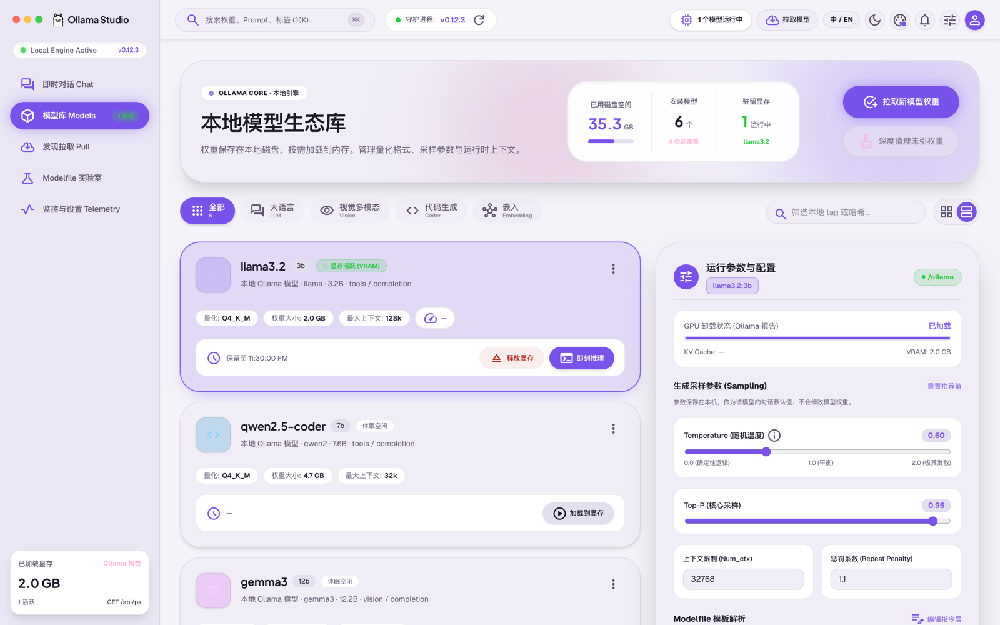
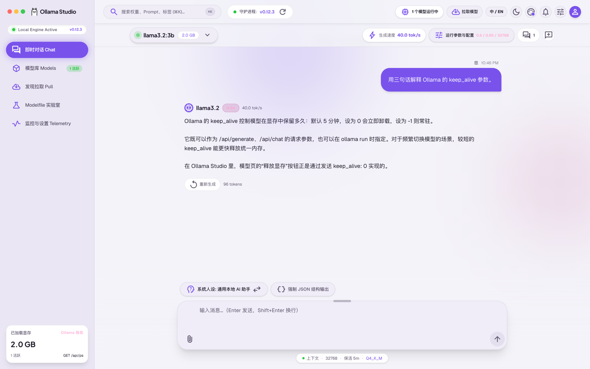
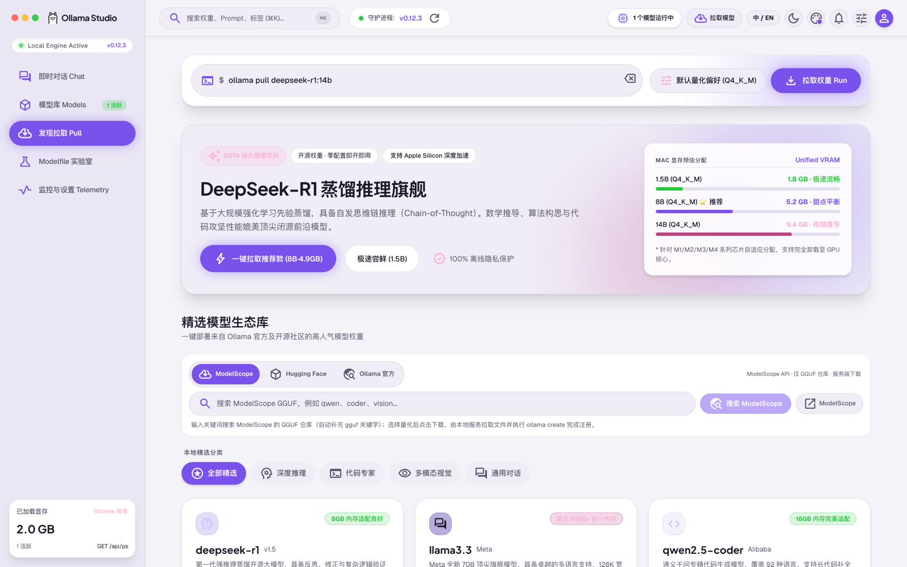
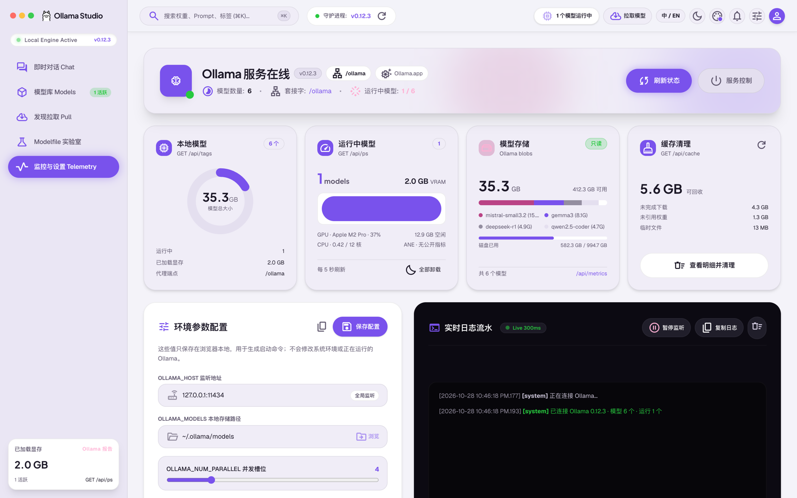

# Ollama Studio

[English](README.md) | **简体中文**

面向 Ollama 本地模型的 macOS 风格模型管理与对话界面。模型列表、运行状态、流式对话、拉取、删除/克隆、Modelfile 构建、GGUF 导入与导出都调用本机 Ollama；会话、模型参数与下载任务元数据保存在浏览器本地。

> 实时状态与下一步见 [`docs/context/NOW.md`](docs/context/NOW.md)；已知风险见 [`docs/context/RISKS.md`](docs/context/RISKS.md)。

## 界面预览

> 截图为演示数据，不代表本机实际模型或设备信息。点击图片可查看大图。

| 模型库                                                                                                                                 | 即时对话                                                                                                                                           |
| -------------------------------------------------------------------------------------------------------------------------------------- | -------------------------------------------------------------------------------------------------------------------------------------------------- |
| [](docs/assets/screenshots/zh/models.png)            | [](docs/assets/screenshots/zh/chat.png)                            |
| **发现与拉取**                                                                                                                         | **监控与设置**                                                                                                                                     |
| [](docs/assets/screenshots/zh/pull.png) | [](docs/assets/screenshots/zh/telemetry.png) |

## 项目定位

Ollama Studio 把本地模型的日常操作集中到一个界面里：浏览和筛选模型、拉取与量化选择、对话与参数调节、用 Modelfile 派生模型、查看守护进程与推理遥测。界面按 Material 3 Expressive 风格实现，支持明暗主题、五套强调色和中英双语。

当前是**可运行的 Web 应用**。默认只监听本机；如需局域网访问，可显式开启并配置共享令牌。

## 平台支持

**macOS 是主要目标平台**，也是唯一完成完整运行时验收的平台。Linux / Windows 为尽力支持：表格反映代码路径与 CI 结果，不代表已完成完整运行时验收。

图例：✅ 已验证/可用 · ⚠️ 已实现但未完成运行时验收，或部分可用 · ❌ 不可用。

| 能力                       |    macOS     |   Linux    |   Windows   |
| -------------------------- | :----------: | :--------: | :---------: |
| 界面、聊天、拉取、模型管理 |      ✅      |     ⚠️     |     ⚠️      |
| GGUF 导入/导出             |      ✅      |     ⚠️     |     ⚠️      |
| 缓存扫描/清理              |      ✅      |     ⚠️     |     ⚠️      |
| 磁盘/内存/CPU 指标         |      ✅      |     ⚠️     |     ⚠️      |
| GPU 指标                   |  ✅ `ioreg`  |     ❌     |     ❌      |
| 守护进程检测/复制命令      |      ✅      | ⚠️ systemd |     ❌      |
| 自动重启/停止              |      ⚠️      |     ❌     |     ❌      |
| 环境变量启动命令           |      ✅      |  ✅ POSIX  | ❌ 仅 POSIX |
| 菜单栏 App / DMG           | ✅ 构建+启动 |     ❌     |     ❌      |

> macOS 的 Ollama.app / launchd / Homebrew 支持自动 daemon 控制，默认关闭，且尚未对真实重启/停止做运行时验收；Linux systemd 仅只读检测。Windows 下 `npm run clean` 与 README 的 POSIX 示例还需适配。GitHub Actions 目前只在 `ubuntu-latest` 运行，覆盖构建与测试，不覆盖真实 Ollama 会话。可选的 macOS 菜单栏封装使用 ad-hoc 签名、未公证；已在仓库内构建并启动，但未安装到 `/Applications`，也未用真实模型下载验收。

## 当前状态（核验于 2026-10-29）

- 已接入 `GET /api/version`、`GET /api/tags`、`GET /api/ps`、`POST /api/chat`（NDJSON 流式）、`POST /api/pull`（NDJSON 进度）、`DELETE /api/delete`、`POST /api/copy`、`POST /api/create`，以及 `ollama create` GGUF 导入与本地 blob 导出。
- 聊天支持流式输出、停止生成、思考内容折叠、温度/topP/num_ctx、JSON 模式、系统人设、错误展示与**每模型多会话**（创建/切换/重命名/删除）。
- 回复中的 fenced code block 会渲染为独立代码块并支持复制。
- 模型参数按模型保存为**对话默认值**（`localStorage`），不会修改模型权重；显存“加载/释放”通过 `keep_alive` 调用真实 API。
- 下载在**服务端后台**执行：拉取任务显示真实状态、速度、剩余时间与进度，可暂停/继续/取消；失败后会显示“将重跑”的具体命令，可点“重试”原样重跑，或点“编辑命令”把命令填回输入框修改（远程 GGUF 任务的仓库与文件信息会持久化，刷新后仍可重试）；刷新或关闭页面不会中断，重新打开后自动接回并展示进度。
- 模型库关键字搜索支持 **ModelScope（默认）**、**Hugging Face** 与 **Ollama 官方**；量化标签由文件名推断。ModelScope 与 Hugging Face 均由本地服务下载选中的 GGUF 后执行 `ollama create`，下载进度与错误以 NDJSON 回传。Hugging Face 不再经过 Ollama 的 `hf.co` pull，因此代理/DNS 把 CDN 解析为非公网地址时不会再卡住应用内下载。
- 遥测页提供**缓存清理**：扫描 Ollama 模型目录与本应用临时目录，分类显示未引用 blob、未完成下载（`*-partial` 及分块标记）与临时文件，勾选后处理；未引用 blob 不直接删除，而是先移入模型目录下的 `.ollama-studio-trash` 回收站，可手动移回 `blobs/` 恢复；未完成下载与应用临时目录会直接删除。被 manifest 或 Ollama metadata 引用的权重、10 分钟内仍在写入的文件以及有下载进行中的未完成文件不会被处理。manifest 无法解析或 `manifests-v2` 链接悬空时，未引用权重清理会被锁定。确认弹窗可展开每一类查看逐文件明细（名称、大小、修改时间、完整路径），并可在系统文件管理器中定位文件或目录（由本地服务执行，Web 版同样可用）。
- 遥测页显示真实连接状态、版本、模型/显存统计与事件日志；侧栏“已加载显存/运行模型数”与遥测页每 5 秒自动轮询 `/api/ps`，外部加载/卸载模型后无需手动刷新。`GET /api/metrics` 读取模型目录所在文件系统的磁盘总量/已用/可用、内存、CPU load 与 macOS `ioreg` GPU 利用率；不可用时明确显示原因，ANE 没有公开利用率 API。运行中模型卡片可确认后“全部卸载”（`keep_alive: 0`）。
- 模型页支持把已安装模型的当前量化导出为 GGUF：服务端读取 manifest，复制 `model` 层，并把 `projector` 层导出为 `*-mmproj.gguf`；默认写入 `~/Downloads/Ollama Studio`，重名自动追加序号。只导出权重，不包含 template/license/params。大文件优先使用 APFS copy-on-write clone。
- 遥测页“服务控制”面板显示 Ollama 由 Ollama.app、launchd、Homebrew、systemd 还是普通进程管理，生成可复制的重启/停止命令；自动执行默认关闭，只有设置 `ALLOW_DAEMON_CONTROL=1`、请求来自 loopback 且二次确认后才执行。环境变量配置可生成 `ollama serve` 启动命令，但不会写入系统环境，需手动重启后生效。
- 代理默认绑定 `127.0.0.1`；可选 `PROXY_TOKEN` 保护 `/ollama/*`、`/api/import`、`/api/modelscope/*`、`/api/downloads`、`/api/cache`、`/api/export`、`/api/metrics` 与 `/api/daemon`。
- 字体与 Material Symbols 已自托管，不再依赖 Google Fonts。
- 可选的 **macOS 菜单栏 App** 复用同一套本地服务：启动内置 Node 运行时并监听 `127.0.0.1:3210`，在默认浏览器打开仪表盘，菜单栏提供“打开 Web / 打开日志 / 退出”。`npm run build:menu` 生成 `.app` 与 DMG；使用 ad-hoc 签名，仅 macOS，不支持登录项、自动更新与公证。
- 工程化：TypeScript `strict`、ESLint、Prettier、Vitest（133 个测试）、GitHub Actions CI。
- 已用 headless Chrome 对开发/生产首屏、真实模型列表、导出与遥测页做冒烟验证；**未做完整逐页人工视觉/a11y 验收**。
- Hugging Face 由本地服务下载 GGUF 后再执行 `ollama create`；需要本机 `ollama` CLI，每个任务只下载一个 GGUF（上限 20 GB），不支持断点续传；分片 GGUF 与多模态 projector 不会自动合并。

详细状态、阻塞和下一步见 [`docs/context/NOW.md`](docs/context/NOW.md)。

## 功能一览

| 模块             | 已实现                                                                                                                                                                                                                                                                        | 尚未实现 / 边界                                                                                                                                                           |
| ---------------- | ----------------------------------------------------------------------------------------------------------------------------------------------------------------------------------------------------------------------------------------------------------------------------- | ------------------------------------------------------------------------------------------------------------------------------------------------------------------------- |
| 模型库           | 真实模型列表、卡片/列表、分类、搜索、参数默认值持久化、真实删除/克隆、加载/释放显存、导出当前量化 GGUF（含多模态 projector）                                                                                                                                                  | 只导出当前已安装量化；template/license/params 不在 GGUF 内，需另存 Modelfile；默认导出目录固定为 `~/Downloads/Ollama Studio`                                              |
| 发现拉取         | CLI 输入、量化选择、精选模型与独立搜索视图、ModelScope/HF/Ollama 搜索、搜索结果长条列表与分页、可调每页条数（6/12/24）、量化选中与行内下载、服务端后台下载（刷新不中断）、真实进度、ModelScope/Hugging Face 服务端下载 + `ollama create`、暂停/继续/取消、失败重试、GGUF 上传 | 量化由文件名推断；GGUF 导入与远程下载依赖本机 `ollama` CLI；远程下载无断点续传、单文件上限 20 GB，且不会合并分片 GGUF/projector；后台任务在服务端内存中，服务端重启会丢失 |
| 即时对话         | 真实流式 `/api/chat`、停止、思考折叠、参数、JSON、人设、错误提示、多会话、代码块复制、可拖拽调整输入框高度、图片/视频附件（视频抽 3 帧）                                                                                                                                      | Ollama 仅接受 `images`，不支持 PDF/任意文件；真实多模态推理未做自动化验收                                                                                                 |
| Modelfile 实验室 | 可视化生成 `FROM` / `PARAMETER` / `SYSTEM`、预设、真实 `/api/create`、测试对话                                                                                                                                                                                                | 参数编辑不会同步到已有模型                                                                                                                                                |
| 监控与设置       | 真实连接/版本/模型/显存统计、事件日志、模型存储卡片、磁盘/内存/CPU/GPU 指标、全部卸载运行模型、配置持久化、缓存扫描与清理（未引用 blob / 未完成下载 / 临时目录，逐文件明细与文件管理器定位）、服务检测与可复制重启/停止命令                                                   | GPU 仅 macOS `ioreg`；ANE 无公开 API；服务自动执行默认关闭且未实测；环境变量只生成命令，不写系统环境                                                                      |
| 全局             | ⌘K 命令面板、主题调色盘、中英切换、明暗模式、移动端底部导航                                                                                                                                                                                                                   | 仍需人工窄屏/a11y 验收                                                                                                                                                    |
| 桌面封装         | macOS 菜单栏 App（Swift/AppKit），内置 Node 服务并生成 DMG；Web UI 仍是主要界面                                                                                                                                                                                               | 仅 macOS；ad-hoc 签名、未公证；固定端口 `3210`；不支持登录项与自动更新                                                                                                    |

## 技术栈

- React 19 + TypeScript 6 + Vite 8 单页应用
- Tailwind CSS v4（通过 `@tailwindcss/vite`）
- 自建 `ThemeContext` 管理主题、强调色、语言；无路由库、无全局状态库
- 开发代理：Vite `server.proxy`（`/ollama`、`/api/catalog`、`/api/hf`）与自建中间件（`/api/import`、`/api/modelscope/*`、`/api/downloads`、`/api/cache`、`/api/export`、`/api/metrics`、`/api/daemon`）
- 生产服务：Express 4 + esbuild 打包的 `server.js`
- 测试与质量：Vitest、ESLint 10（flat config）、Prettier、GitHub Actions
- 字体/图标：`@fontsource-variable/*`、`material-symbols`（本地打包）

版本以 `package.json` / `package-lock.json` 为准，完整映射见 [`docs/context/MAP.md`](docs/context/MAP.md)。

## 快速开始

前置：Node.js、npm，以及本机运行的 Ollama（默认 `http://127.0.0.1:11434`）。GGUF 文件上传还需要运行服务的机器能执行 `ollama` CLI。在项目根目录执行：

```bash
npm install
npm run dev
```

打开 `http://127.0.0.1:3000`。开发服务器默认只监听本机。

如果 `npm install` 因默认缓存权限报 `EPERM`，使用仓库内缓存：

```bash
npm install --cache .npm-cache --no-audit --no-fund
```

### 配置 Ollama 地址

复制 `.env.example` 为 `.env`，按需修改（开发与生产都会读取；进程环境优先）：

```bash
OLLAMA_HOST=http://127.0.0.1:11434
PORT=3000
HOST=127.0.0.1
```

前端默认走同源 `/ollama` 代理，不需要浏览器直连 Ollama。只有浏览器能直接访问 Ollama 时，才设置 `VITE_OLLAMA_BASE_URL`。

### 局域网访问与共享令牌

默认只允许本机访问。需要同一可信网络访问时：

```bash
# 生产：设置共享令牌后再绑定非 loopback
PROXY_TOKEN=change-me HOST=0.0.0.0 npm start

# 前端构建时必须使用相同令牌
VITE_PROXY_TOKEN=change-me npm run build
```

`PROXY_TOKEN` 保护 `/ollama/*` 与本地管理 API（`/api/import`、`/api/modelscope`、`/api/downloads`、`/api/cache`、`/api/export`、`/api/metrics`、`/api/daemon`）；未设置时代理无鉴权。`VITE_PROXY_TOKEN` 会嵌入前端产物，属于共享密钥，不是用户级认证；跨网段使用请再加反向代理与 TLS。开发时可用 `npm run dev:lan` 显式开放，仅限可信网络。

### 生产运行

```bash
npm run build
npm start
```

`npm run build` 同时构建 `dist/` 与 `server.js`；`npm start` 默认监听 `127.0.0.1:3000`，静态托管前端并把 `/ollama/*` 流式转发到 `OLLAMA_HOST`。

### macOS 菜单栏 App（可选）

macOS 上可以用 Swift/AppKit 菜单栏封装复用同一套 Web UI，不需要 Electron 或 Tauri：

```bash
npm run build:menu
open "build/Ollama Studio Menu.app"
```

需要 Xcode Command Line Tools（`swift`、`swiftc`、`iconutil`、`hdiutil`、`codesign`）。构建产物为 `build/Ollama Studio Menu.app` 与 `build/Ollama Studio Menu-0.1.0.dmg`。App 会启动内置 Node 服务并监听 `127.0.0.1:3210`，在默认浏览器打开仪表盘，菜单栏提供“打开 Web / 打开日志 / 退出”。重新打包前需先退出正在运行的实例。应用使用 ad-hoc 签名、未公证，不支持登录项与自动更新；原有 Web 构建与生产服务器不受影响。

### 导出 GGUF

模型页右侧操作区的“导出 GGUF”会把当前已安装量化写入默认目录 `~/Downloads/Ollama Studio`，重名时自动追加 `-2`、`-3`。多模态模型的 `projector` 层会单独写成 `*-mmproj.gguf`；template/license/params 不属于 GGUF，需要另行保存 Modelfile。导出由本地服务读取 `OLLAMA_MODELS`（默认 `~/.ollama/models`）完成，优先使用 APFS copy-on-write clone；跨文件系统时是完整复制，请预留空间。

### 可用脚本

| 命令                                   | 作用                                        |
| -------------------------------------- | ------------------------------------------- |
| `npm run dev`                          | Vite 开发服务器，`127.0.0.1:3000`           |
| `npm run dev:lan`                      | 显式绑定 `0.0.0.0:3000`（仅可信网络）       |
| `npm run build`                        | 构建 `dist/` + `server.js`                  |
| `npm run build:web` / `build:server`   | 仅构建前端 / 仅打包服务端                   |
| `npm run build:menu`                   | 构建 macOS 菜单栏 `.app` 与 DMG（仅 macOS） |
| `npm start`                            | 运行生产服务器                              |
| `npm run preview`                      | 预览构建产物                                |
| `npm run typecheck`                    | `tsc --noEmit`                              |
| `npm run lint` / `lint:fix`            | ESLint 检查 / 自动修复                      |
| `npm run format` / `format:check`      | Prettier 格式化 / 检查                      |
| `npm test` / `test:watch` / `coverage` | Vitest 测试 / 监听 / 覆盖率                 |
| `npm run clean`                        | 删除 `dist/`、`server.js`、`coverage/`      |

前置条件、产物、验证步骤和执行状态见 [`docs/context/RUNBOOK.md`](docs/context/RUNBOOK.md)。

## 验证状态

- `npm run typecheck`、`npm run lint`、`npm run format:check`、`npm test`（133 个测试）、`npm run build`：2026-10-29 全部通过。
- GitHub Actions CI：首次远端运行（[40739185722](https://github.com/HaoRangQi/Ollama-Studio/actions/runs/40739185722)）在 `ubuntu-latest` + Node 24 上通过 typecheck、lint、format check、测试与构建。
- 服务端后台下载与缓存清理：ModelScope 下载中两次刷新进度连续（63.1% → 80.1%）；缓存清理在 fixture 上将未引用 blob 移入回收站并保留被引用 blob；明细弹窗按体积列出文件并可定位到文件管理器；真实 `~/.ollama/models` 只读扫描到 6 个被引用 blob（约 21.8 GB），未执行 orphan 清理。
- Hugging Face 服务端直下：真实下载 1,185,376 字节 GGUF（经 `huggingface.co` 302 到 CDN），流式写入临时目录并调用假 `ollama create`；`resolving → downloading → creating → success` 的 `completed/total` 一致，临时目录无残留。CDP 验证搜索结果下载按钮与粘贴 `hf.co/<repo>:<quant>` 均向 `/api/downloads` 发送 `kind:"huggingface"`，`/api/pull` 调用为 0。**未下载大模型，未向真实 Ollama 注册模型。**
- 菜单栏 App：`npm run build:menu` 生成 `Ollama Studio Menu.app` 与 DMG；重新打包后启动成功，内置服务监听 `127.0.0.1:3210`，非法 Hugging Face 仓库/文件请求返回预期 400。包内包含 `server/package.json`（`{"type":"module"}`），不依赖仓库根目录的 package.json。**未安装到 `/Applications`，未通过 App 发起真实模型下载。**
- Chat 导航视觉：headless Chrome 在 1600×1000 下验证深色/浅色与电光薰衣草/赛博翡翠组合的渐变、光晕、流光与 `flare` 星芒；按钮尺寸仍为 223×44 px。README 截图未因这次小改动重新生成。
- 侧栏状态轮询：CDP mock `/ollama/api/ps` 从 0 个运行模型切到 1 个（`size_vram=926000000`）再切回 0，侧栏在 6.5 秒内依次显示 `— / 0 活跃` → `926 MB / 1 活跃` → `— / 0 活跃`，无需手动刷新。
- 失败重试：CDP mock `/api/downloads` 分别注入 pull 与 ModelScope 失败任务，点击“重试”后 POST body 与原始任务一致（ModelScope 的 `file` 从持久化 source 恢复），轮询转为完成；失败卡片显示“将重跑：`ollama pull <model>`”，点“编辑命令”会把命令填回输入框并聚焦；旧 ModelScope 任务缺少 `kind/source` 时按 `.gguf` 文件名推断，不会误走 `ollama pull`；`pull model manifest: file does not exist` 会追加 HF/ModelScope 操作提示。
- 生产服务器（3101）与开发服务器（3001）：`/healthz`、`/ollama/api/version`、`/ollama/api/tags`、`/api/import` 校验与 headless Chrome 首屏渲染通过。
- 代理令牌：无令牌 401、Bearer 令牌 200、`/api/import` 无令牌 401，均已验证。
- 图片/视频附件：CDP 选择 PNG + WebM，视频抽 3 帧；mock `/api/chat` 捕获到 4 个 `images` 和默认描述文本；未执行真实视觉推理。
- GGUF 导出：fixture 通过 `POST /api/export` 导出 model + projector，内容与重名序号正确；越界目录 403、非法模型名 400；真实 0.8B 模型导出 529,297,312 字节，文件头为 `GGUF`，SHA256 与 manifest 的 `sha256:fb89581…` 一致，耗时约 1.2 秒（APFS clone）。CDP mock 验证模型页按钮请求 `{model:"diodel/qwen3.5-0.8b-q4_k_m-gguf:latest"}` 并显示含 mmproj 的成功 toast。
- 系统指标与服务检测：`GET /api/metrics` 返回真实磁盘容量、内存、CPU load 与 macOS `ioreg` GPU 利用率（本机 Apple M1 Pro）；`GET /api/daemon` 识别 Ollama.app 与 PID，`POST /api/daemon/control` 在未设置 `ALLOW_DAEMON_CONTROL=1` 时返回 403；CDP 确认遥测页显示 GPU、磁盘已用、启动命令、全部卸载与服务控制面板。
- **未执行**：真实 UI 中的模型加载/卸载与“全部卸载”、真实多模态推理、完整逐页视觉/窄屏/a11y 验收、真实大模型 HF 下载与真实 `ollama create`、真实 20 GB 级模型导出、daemon 自动重启/停止（含 macOS Automation 权限弹窗）、systemd/Windows 分支。

## 文档

| 文档                                                               | 用途                              |
| ------------------------------------------------------------------ | --------------------------------- |
| [`AGENTS.md`](AGENTS.md)                                           | 协作规则、读取/写入约束、验证要求 |
| [`PROJECT_INDEX.md`](PROJECT_INDEX.md)                             | 任务到文件/章节的路由             |
| [`docs/context/NOW.md`](docs/context/NOW.md)                       | 当前目标、进展、阻塞、下一步      |
| [`docs/context/MAP.md`](docs/context/MAP.md)                       | 目录、版本、配置、部署关系        |
| [`docs/context/RUNBOOK.md`](docs/context/RUNBOOK.md)               | 操作步骤、前置条件、执行状态      |
| [`docs/context/DECISIONS.md`](docs/context/DECISIONS.md)           | 已确认决策与待决策                |
| [`docs/context/RISKS.md`](docs/context/RISKS.md)                   | 风险、验证缺口、保护措施          |
| [`docs/context/history/README.md`](docs/context/history/README.md) | 历史归档索引                      |

## 来源与设计参考

- 原始 AI Studio 应用：https://ai.studio/apps/9ab4837f-c57f-4777-a911-4ac097c9b6ee
- 原 `README.md` 为 AI Studio 导出模板；2026-10-27 重写为项目说明，保留原始应用链接与本地运行步骤。
- `public/assets/aistudio/` 保存设计参考（截图、HTML、Material 3 色彩 token），当前未被应用代码引用。

## 许可

Apache License 2.0，见 [`LICENSE`](LICENSE)。
